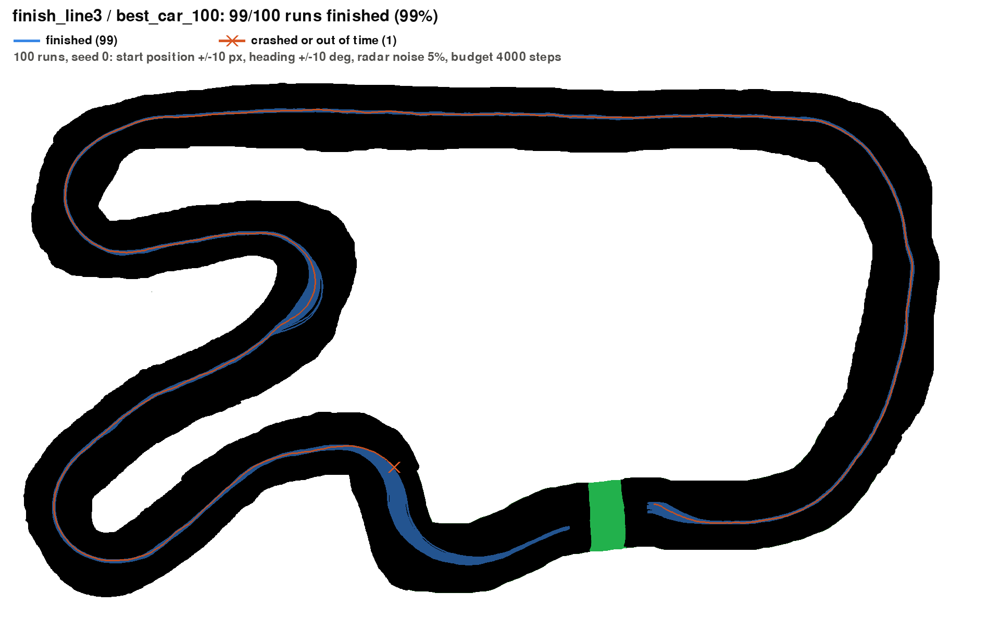
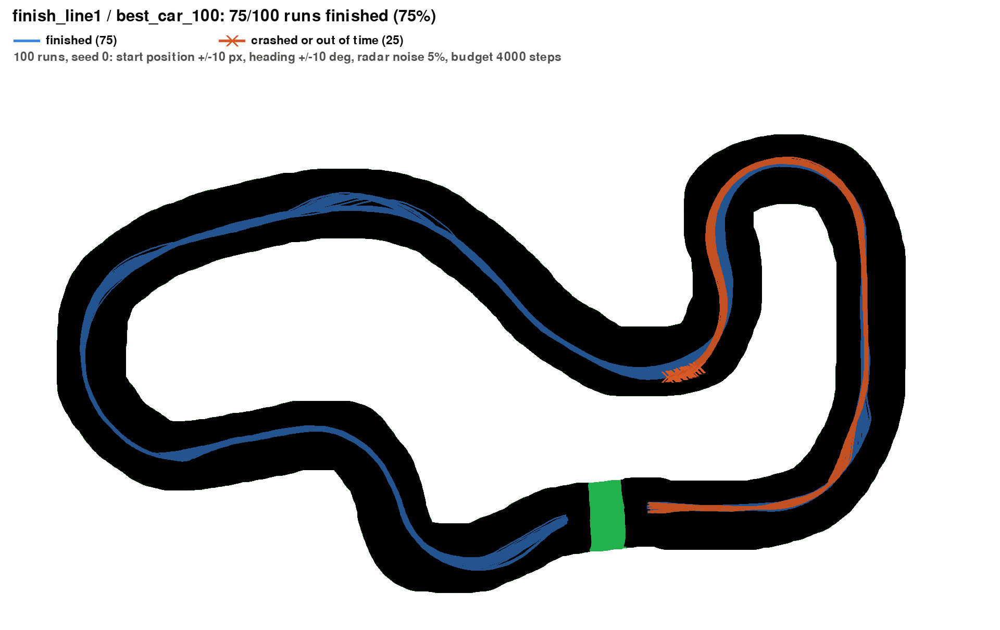

# Evaluation

Added in November 2026 to measure the trained cars from the original project.
To perform the evaluations, run all commands from the repository root:

```
pip install -r evaluation/requirements.txt
```

## Reliability of saved models

The simulation is deterministic: a car always starts in the same spot, the
network has no randomness and the radars read fixed map pixels, so running a
saved model twice gives exactly the same run. To measure how reliably a model
completes a track, `evaluate.py` runs each saved model 100 times with:

- a random start position, up to ±10 px from the usual one
- a random start heading, up to ±10°
- 5% Gaussian noise on every radar reading

A run counts as completed when the car reaches the green finish line. `main.py`
has no time limit, so each run gets up to 4,000 steps, twice the 2,000 steps
per generation used in training; a car still driving after that counts as out of
time. Each model is also run once without any changes, which is exactly the
run `main.py` plays. The 95% confidence interval is a Wilson score interval.

```
python3 -m evaluation.evaluate --plot
```

| Track | Model | Unperturbed run | Runs completed | 95% CI | Crashed | Out of time | Median steps to finish |
|---|---|---|---|---|---|---|---|
| finish_line1 | best_car_50 | finished | **7/100** | 3–14% | 93 | 0 | 972 |
| finish_line1 | best_car_100 | finished | **75/100** | 66–82% | 25 | 0 | 732 |
| finish_line1 | best_car_150 | finished | **74/100** | 65–82% | 26 | 0 | 636 |
| finish_line2 | best_car_50 | finished | **22/100** | 15–31% | 78 | 0 | 2102 |
| finish_line2 | best_car_100 | finished | **59/100** | 49–68% | 41 | 0 | 2120 |
| finish_line2 | best_car_150 | finished | **91/100** | 84–95% | 9 | 0 | 1921 |
| finish_line3 | best_car_50 | finished | **100/100** | 96–100% | 0 | 0 | 2344 |
| finish_line3 | best_car_100 | finished | **99/100** | 95–100% | 1 | 0 | 1724 |
| finish_line3 | best_car_150 | finished | **76/100** | 67–83% | 24 | 0 | 1446 |
_100 runs, seed 0: start position +/-10 px, heading +/-10 deg, radar noise 5%, budget 4000 steps._

The model used in the game, `finish_line3/best_car_100`, completed 99 of the
100 runs, and again 99/100 with a different seed (`--seed 1`). With twice the
perturbation (`--pos-jitter 20 --angle-jitter 20 --sensor-noise 0.1`) it
completed 97/100.



Failures tend to happen at the same corner, for example on `finish_line1`:



## Fitness function experiment

The original fitness function, in `model/ai_car.py`, rewards distance driven
and triples it if the car is still driving when time runs out, after 2,000
steps. Reaching the finish line ends a run, so it loses that bonus. On
`finish_line3`, this formula gives `best_car_50`, which is still driving at
step 2,000, a score of 2,579, and `best_car_150`, which finishes in 1,182
steps, a score of 1,058: the slower car wins.

`fitness_experiment.py` trains new populations from scratch with either that
fitness function (`distance`) or one that adds a bonus for reaching the finish
line, larger the sooner the car gets there (`finish`). The new formula scores
the same two cars 860 and 2,467. The script reuses the original training code
and saves to `evaluation/runs/`. Training is deterministic for a given seed, so
two runs with the same seed differ only in the fitness function.

```
python3 -m evaluation.fitness_experiment --fitness distance --seed 0
python3 -m evaluation.fitness_experiment --fitness finish --seed 0
# ...the same for seeds 1 and 2, then:
python3 -m evaluation.evaluate --model-dir evaluation/runs/finish_line3/* --model best_car_150.pkl
```

### Results

Each trained model was evaluated the same way as the saved models above; the
full results are in `results/experiment.md`. The training score is the
fitness of the best car in the run, as stored in its model file.

| Seed | `distance`: runs completed | `distance`: training score | `finish`: runs completed | `finish`: training score |
|---|---|---|---|---|
| 0 | 0/100 | 789 | 0/100 | 789 |
| 1 | 72/100 | 2,981 | 22/100 | 996 |
| 2 | 29/100 | 2,923 | 98/100 | 800 |

The new fitness function made no measurable difference. Each fitness function
produced one model that never finishes, one that sometimes does and one that
usually does.

The training scores show why. With the `finish` fitness, a car that reaches the
finish line during training scores at least 2,000, but no `finish` run scored
above 996. No car reached the finish line within the 2,000-step limit, so the
bonus never applied. A lap of `finish_line3` takes about 2,500 steps at the
minimum speed, and the best `finish_seed2` car scored exactly 800, the score for
driving at the minimum speed for all 2,000 steps. Without the bonus, the
`finish` fitness is just the distance driven: the old formula without its ×3 for
cars still driving at the end.

Seed 0 is the same run with both fitness functions. Every car crashed in every
generation (a car still driving at the end would have scored at least 2,400
with the `distance` fitness), so the two formulas never scored a car
differently.

A 4,000-step limit would let cars finish even at the minimum speed, so the bonus
could apply (`--steps 4000`). That hasn't been run.
